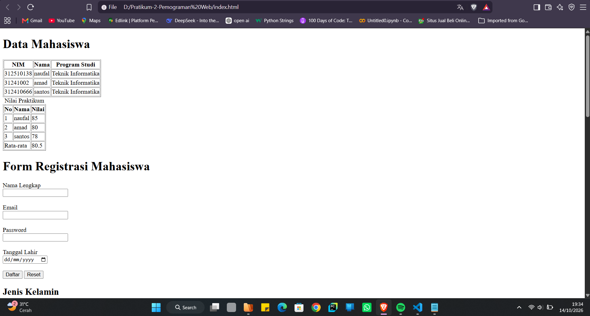

# Praktikum Pemrograman Web — Lab2Web

Repository ini berisi hasil Praktikum 2 mata kuliah Pemrograman Web. Praktikum berfokus pada penggunaan tabel, formulir, validasi input, semantic HTML, multimedia, dan pembuatan proyek mini biodata mahasiswa.

## Tujuan Praktikum

- Memahami struktur tabel HTML dan penggunaannya.
- Membuat formulir dengan berbagai jenis input.
- Menerapkan validasi form dasar.
- Menggunakan elemen semantic HTML.
- Menambahkan multimedia ke halaman web.
- Menggabungkan materi ke dalam proyek mini biodata mahasiswa.

## Teknologi yang Digunakan

- HTML5
- Browser web untuk melihat hasil halaman

## Daftar Latihan

### 1. Membuat Tabel Data Mahasiswa
Membuat tabel untuk menampilkan data mahasiswa, seperti NIM, nama, dan program studi.

### 2. Mengembangkan Tabel dengan `thead`, `tbody`, dan `tfoot`
Mengelompokkan bagian kepala tabel, isi tabel, dan bagian kaki tabel agar struktur data lebih terorganisasi.

### 3. Membuat Form Registrasi Mahasiswa
Membuat formulir registrasi yang berisi input seperti nama lengkap, email, password, dan tanggal lahir.

### 4. Radio Button dan Checkbox Studi
Menggunakan radio button untuk memilih satu opsi jenis kelamin serta checkbox untuk memilih satu atau beberapa keahlian.

### 5. Select dan Textarea
Menggunakan elemen `select` untuk memilih program studi dan `textarea` untuk memasukkan alamat atau teks yang lebih panjang.

### 6. Validasi Form Dasar
Menerapkan atribut validasi HTML, seperti `required`, `min`, `max`, dan `minlength`, agar input memenuhi ketentuan dasar.

### 7. Membuat Halaman Semantic HTML
Menyusun halaman menggunakan elemen semantic, seperti `header`, `nav`, `main`, `section`, `article`, `aside`, dan `footer`.

### 8. Menambahkan Multimedia
Menambahkan elemen multimedia HTML, seperti `audio` dan/atau `video`, ke dalam halaman web.

### 9. Proyek Mini — Form Biodata Mahasiswa
Menggabungkan materi praktikum menjadi halaman biodata mahasiswa yang memuat tabel, formulir, pilihan input, validasi dasar, semantic HTML, dan multimedia.

## Dokumentasi Screenshot

### 1. Tabel Data Mahasiswa

### 2. Form Registrasi Mahasiswa

### 3. Proyek Mini — Biodata Mahasiswa

## Kesimpulan

Melalui praktikum ini, saya mempelajari dasar pengembangan halaman web menggunakan HTML, mulai dari menyajikan data dalam tabel, membuat dan memvalidasi formulir, menyusun struktur halaman dengan semantic HTML, hingga menambahkan multimedia. Materi tersebut diterapkan dalam proyek mini berupa form biodata mahasiswa.

---
